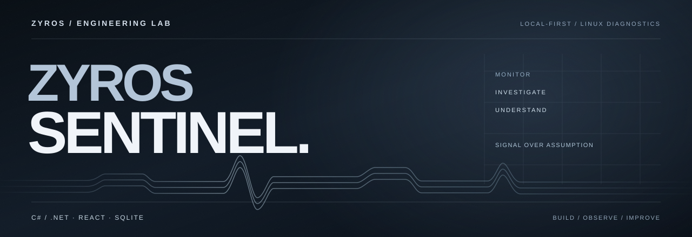

  

  <strong>Understand the system. Investigate the signal.</strong>

  A local-first monitoring and diagnostics experience for Linux.

---

01 / OVERVIEW

## Visibility that leads to understanding.

**Zyros Sentinel** is an independent software engineering project focused on **Linux observability, resource monitoring and practical troubleshooting**.

The idea is to go beyond a collection of CPU and RAM percentages. Zyros Sentinel aims to bring measurements, system state and historical context into a single experience, helping people understand **what changed, when it changed and where to investigate next**.

It is designed around a simple principle: **show the evidence, explain the limits, and avoid presenting assumptions as facts.**

 

02 / THE EXPERIENCE

## From signals to insight.

| OBSERVE | INVESTIGATE | UNDERSTAND |
| :--- | :--- | :--- |
| Follow the condition of a Linux system through real resource measurements. | Explore processes, services and relevant diagnostic context when something changes. | Put current readings alongside historical trends and incident timelines. |

The product explores several areas of system visibility:

- **System overview:** CPU, memory, storage, network activity, uptime and system load.
- **Process diagnostics:** resource consumption and changes over time.
- **Service health:** status information for system services and investigation of failures.
- **Incident context:** observed anomalies, timelines and supporting measurements.
- **Local history:** historical trends that make one-off readings easier to interpret.
- **Reports:** structured snapshots for review or comparison.

Availability and depth vary as the project evolves. Some features are experimental or still being refined.

 

03 / DESIGN PRINCIPLES

## Built for operators. Clear enough for learners.

**Evidence before conclusions.** A high reading is a signal to investigate, not a diagnosis on its own.

**Guided or technical.** Accessible explanations help new users, while detailed measurements support experienced operators.

**Local-first by design.** The experience prioritizes local collection and review without depending on a hosted monitoring account.

**Read-only diagnostics.** The purpose is to observe and understand a system — not silently change services or repair an installation.

 

04 / TECHNOLOGY

## Engineering behind the interface.

| Technology | General role |
| :--- | :--- |
| **C# / .NET** | System diagnostics, measurement collection and application logic. |
| **React / JavaScript** | Interactive monitoring interface and data presentation. |
| **SQLite / SQL** | Local records and historical measurements. |
| **Linux** | The operating environment being monitored. |

The application evolves through iterative implementation, testing and review. Internal architecture, commands and deployment configuration are intentionally not part of this public overview.

 

05 / PROJECT STATUS

## In active development.

Zyros Sentinel is an **experimental software project**, not a certified security product, a production monitoring service or a guarantee of system health.

This public repository is a **product showcase only**. It does not include the application source code, private development history, credentials, binaries or internal configuration.

  ZYROS / SENTINEL — OBSERVE. INVESTIGATE. UNDERSTAND.

